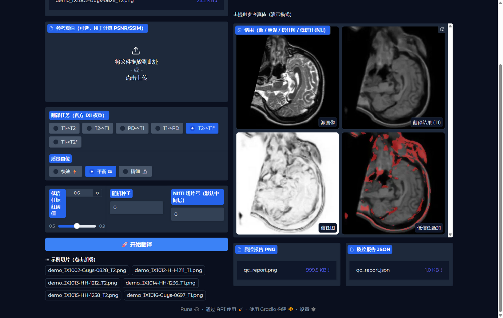

# TrustBridge · MedBridge Studio

**为医学图像翻译设计的临床安全分诊护栏** —— 基于 SelfRDB 自洽递归扩散桥
（Arslan et al., arXiv:2405.06789, MIT）的可信翻译工作台。

TrustBridge 在合成**之前**拦截错模态 / 解剖部位不符 / 域外退化输入（1,160 例验证矩阵中
562 例非法输入零漏放）；在合成**之后**给出逐像素信任图与三级分诊建议（PASS → REVIEW → REJECT），
并输出可打印归档的质控报告。



> 学术研究、实验与论文请见姊妹仓库：**[TrustBridge-Paper](https://github.com/ASHDUSK/TrustBridge-Paper)**

## 研究背景

医学图像翻译（如 T1→T2 MRI 合成、MRI→CT 合成）可以减少重复扫描与造影剂/电离辐射暴露，
但生成模型的"自信幻觉"使其难以直接进入临床流程：模型对失败样本同样输出看起来合理的图像。
TrustBridge 的立场是：与其宣称万能，不如公开测量并守卫每一种失效——

- **复现性危机**：官方 SelfRDB 权重在自备 IXI 数据上只能跑到 ~15 dB（论文报告 31.56 dB）。
  我们完整公开排查过程与自训管线（[docs/03_复现性排查与验证报告.md](docs/03_复现性排查与验证报告.md)），
  自训模型线性强度校正后 31.74 / 32.52 dB，内容保真度与论文同级；
- **评估陷阱**：背景空气像素会系统性虚高整图口径的 UQ 指标（同一信号整图 AUROC 0.90 →
  体区内 0.78）。**所有信任指标必须按体掩码口径计算**——我们撤回了早期虚高数字；
- **失效边界**：把自守卫的每一种失效（自信幻觉、结构性崩塌、肿瘤盲区、退化盲区）作为
  边界地图公开（详见论文仓库）。

## 核心功能

| 功能 | 说明 |
|---|---|
| 单图翻译 | PNG/JPG/NIfTI/DICOM 输入 → 翻译结果 DICOM（Secondary Capture）+ 质控报告 PDF/PNG/JSON；示例切片自动匹配任务 |
| 六类输入门控 | 错模态/错部位/域外输入在合成**之前**拦截（脑任务硬拒绝），不产生任何伪造评分 |
| 整卷 NIfTI | 逐层 Trust Score 曲线（低于阈值切片定位）、翻译卷 NIfTI 导出 |
| 批量质控 | 错配输入记 `GATE_BLOCKED` 不合成，汇总 CSV + 排序图 |
| 部署校准向导 | 用机构自有标注切片重整定三级阈值 |
| 信任采样器 | CReF（收敛残差场）+ 随机桥集成，自适应递归停机与步长跳跃加速 |
| 一键评估外部模型 | `evaluate_your_model.py` 把任意翻译模型接入体掩码口径评估 |
| 微服务 API | FastAPI `/gate`（毫秒级门控）与 `/evaluate`（翻译+分诊 JSON），可对接 HIS/PACS |

## 系统架构

```
PNG/NIfTI/DICOM 输入
      │
      ▼
trustbridge/gate_v2 ── OOD/MISMATCH ──▶ 拒绝（不合成、无评分）
      │ MATCH
      ▼
trustbridge/engine ──▶ third_party/SelfRDB（DiffusionBridge + NCSNpp 生成器）
      │                       ▲ checkpoints/*.ckpt（12 个任务）
      ▼
trustbridge/sampler ─ CReF + 集成不确定性 + 自适应步跳 ─▶ TrustResult
      │           （trust_map / rcrf_map / unc_map / trust_score / qc_flag）
      ▼
trustbridge/pipeline ─▶ trustbridge/report ─▶ QC 报告 PNG/PDF/JSON
      │
      ├── app/app.py        Gradio 工作台（MedBridge Studio）
      └── api.py            FastAPI 微服务（/gate、/evaluate）
```

模块职责与调用关系详见 **[docs/architecture.md](docs/architecture.md)**。

## 环境安装

```bash
# Python 3.13 实测（3.10+ 应可）；建议虚拟环境
pip install torch --index-url https://download.pytorch.org/whl/cu126  # 先装 CUDA 版 PyTorch（实测 2.14.0+cu126）
pip install -r requirements.txt
```

下载权重（官方 SelfRDB 权重 MIT 公开；自训权重获取方式见脚本头注释）：

```bash
bash scripts/download_checkpoints.sh   # 落入 checkpoints/（.gitignore 排除）
```

数据仅用于科研：IXI（brain-development.org）、BraTS2018、SynthRAD2023，
来源与许可声明见 [docs/DATA.md](docs/DATA.md)。

## 快速启动

```bash
# 1) 一键评估你自己的翻译模型（体掩码口径 + 整图口径对照）
python scripts/evaluate_your_model.py --demo   # 用仓库自训模型演示
# 接入你的模型：模块提供 predict_pair(src01)->(pred01, trust_2d)，见脚本头注释

# 2) 启动本地应用
python app/app.py                 # → http://127.0.0.1:7860

# 3) 微服务模式
uvicorn api:app --port 8000       # GET /docs 查看交互式 API 文档
```

## API 使用

| 端点 | 功能 | 典型用途 |
|---|---|---|
| `POST /gate` | 仅输入门控（毫秒级，不占 GPU），返回 verdict / pred_class / maha | 前置拦截错模态/域外输入 |
| `POST /evaluate` | 翻译 + 信任分诊，返回 trust_score / qc_flag / suspicious_regions | 报告级质量评估 |
| `GET /docs` | 交互式 OpenAPI 文档 | 联调 |

Docker 骨架见 [Dockerfile](Dockerfile)（GPU 直通，权重/数据卷挂载）。

## 目录说明

```
trustbridge/         核心创新层（engine/sampler/pipeline/gate/gate_v2/report/io_utils/...）
app/                 MedBridge Studio（Gradio）+ IXI 示例切片
api.py               FastAPI 微服务入口
scripts/             数据准备（prepare_*）/ 训练（train.py, train_gate_v2.py）/
                     评估（eval_*, evaluate_your_model.py）/ 绘图（make_*）/
                     工具（build_demo_package, sync_demo_package, tex2html, paper_pdf）
configs/             自训练配置（官方 10 步扩散桥配方，128²）
docs/                用户手册 / 架构说明 / 门控验证矩阵 / 复现性排查 / 消融报告 / 数据许可
third_party/SelfRDB/ vendored 官方代码（MIT，见其 VENDORED.md）
results/             评估结果汇总（JSON + 逐片 CSV；论文正式实验结果见论文仓库）
assets/              应用截图
```

## 研究局限

- Trust Score 与三级阈值为演示默认值，**未经临床标定**；部署前必须用机构数据重校准；
- 图像级分数是参考值：低信任区定位可靠，图像级"总分"不构成质量保证；
- 信任图不定位肿瘤（瘤内信任反而更高，AUROC≈0.51）；肿瘤病例需人工复核；
- 官方权重的个别方向上信任信号近随机（边界地图详见论文）；
- 光度型崩塌（纯强度偏移）信任图不报警属正确语义，但需另行光度检查；
- 合成结果仅供科研与教学演示，**不得直接用于临床诊断决策**。

## 许可证与引用

- 代码：MIT License（与本方法基座 [SelfRDB](https://github.com/icon-lab/SelfRDB) 一致）。
- 学术成果（陷阱、基线、边界实验的完整论证）见论文仓库：

```bibtex
# 论文 BibTeX（投稿定稿后在此更新；当前版本与论文仓库同步）
```

- 使用本工具时请同时引用 SelfRDB 原论文：F. Arslan et al.,
  *Self-Consistent Recursive Diffusion Bridge for Medical Image Translation*,
  arXiv:2405.06789。
